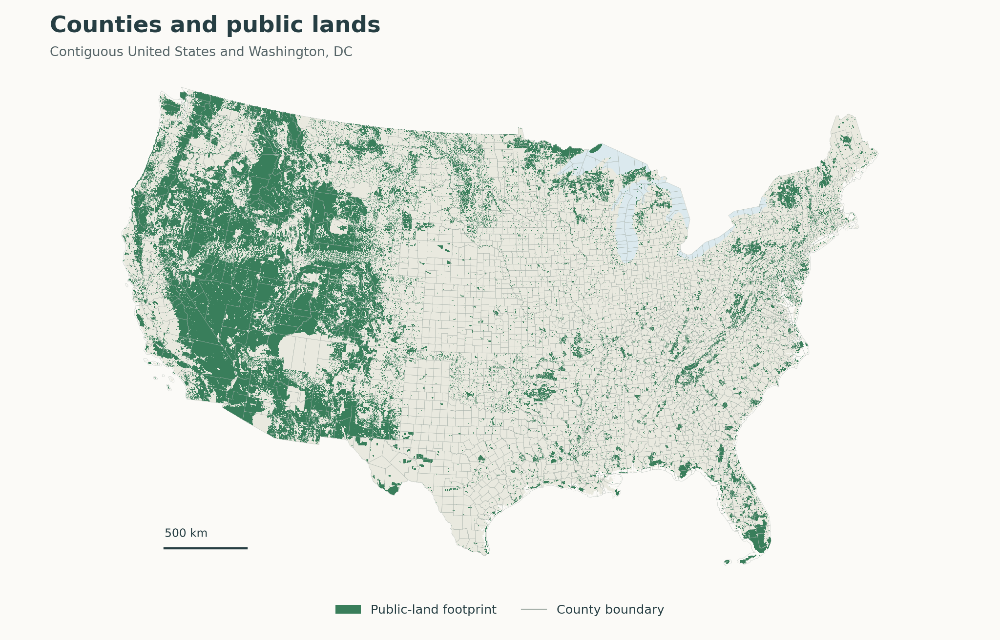
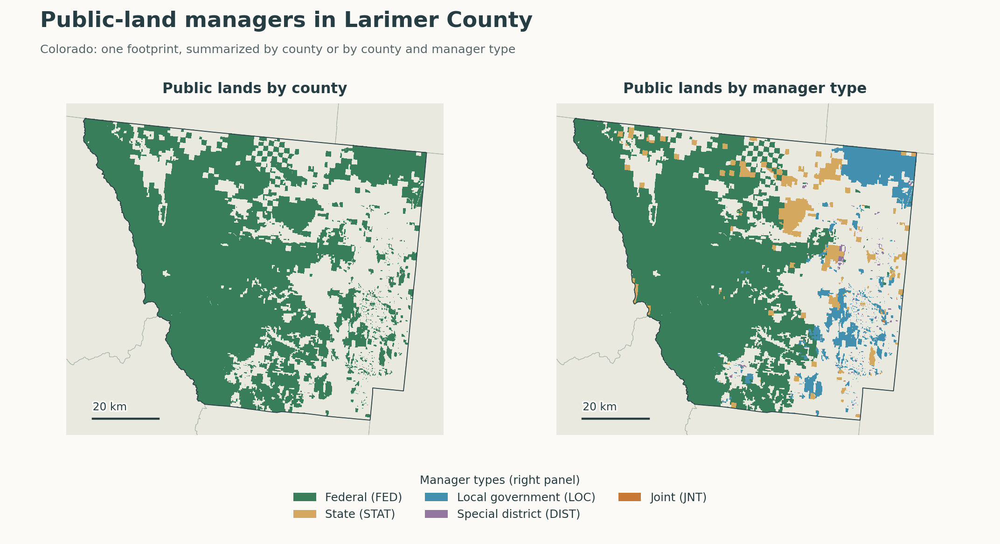
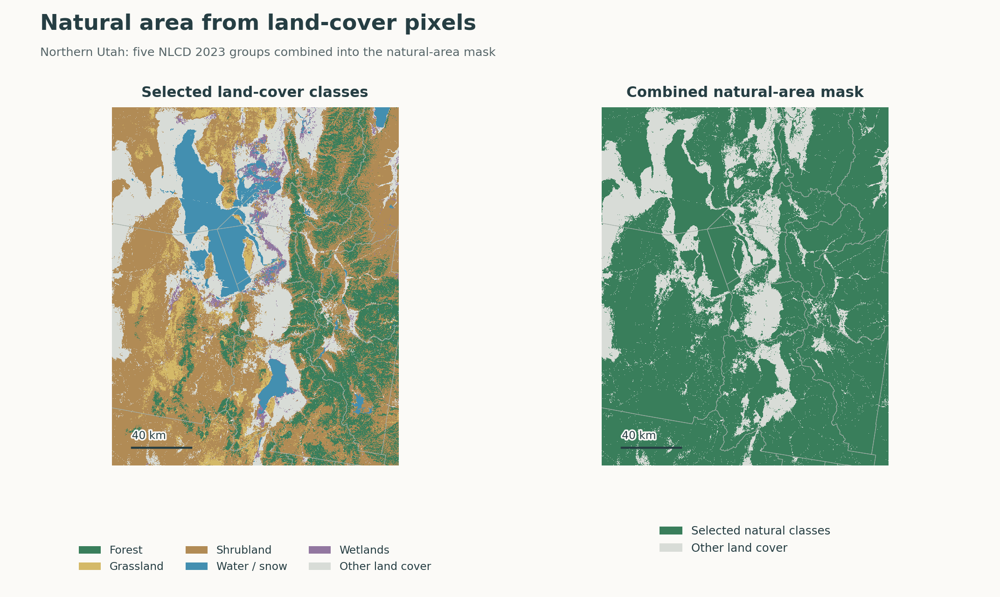
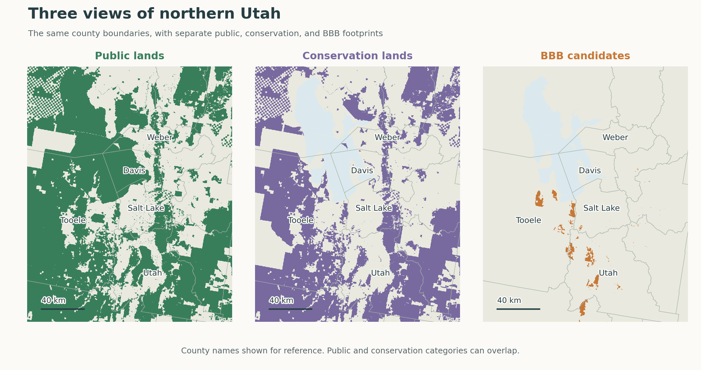
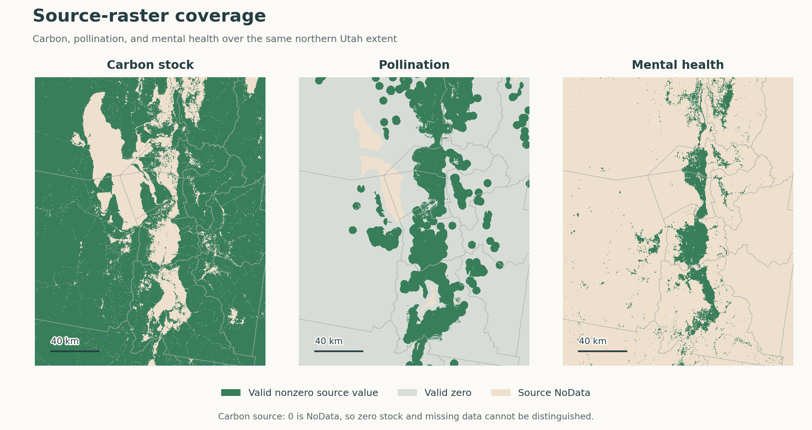
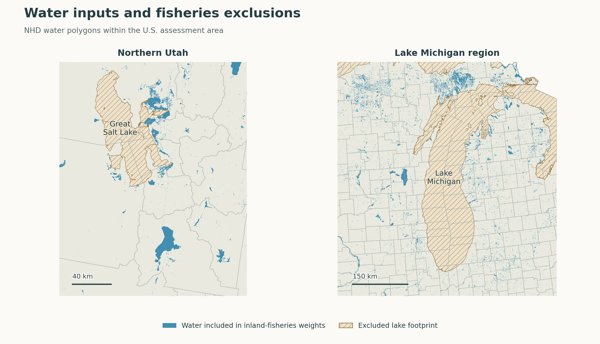

# CONUS Ecosystem Services Assessment

This repository implements a data pipeline that estimates the monetary value
of ecosystem services across the contiguous 48 states and Washington, DC
(CONUS). It combines raster, tabular, and vector datasets and produces six
output layers, each as a CSV and GeoPackage pair:

1. Counties
2. Public lands by county
3. Public lands by county and manager type
4. Conservation lands by county
5. Conservation lands by county and manager type
6. Big Beautiful Bill (BBB) candidate lands by county



*Public-land footprints across the assessment's 3,109 counties and county
equivalents. The maps use local assessment data; their sources and rendering
settings are recorded in the [figure provenance](docs/images/map_sources.json).*

## How the assessment works

The assessment brings together ecosystem-service estimates supplied as raster
maps, county and state tables, and mapped study sites. We summarize or
distribute these estimates across counties and the public, conservation, and
BBB lands within them. We then apply unit conversions and monetary adjustments
to report individual service values, combined totals, and county comparisons.

The pipeline follows four stages:

1. [Define the analysis areas](#define-analysis-areas) and
   [measure their land, water, and shoreline](#measure-area-and-shoreline).
2. Estimate ecosystem-service values for each area by
   [summing raster values](#summarize-ecosystem-service-rasters) and
   [assigning estimates from tables and study sites](#allocate-service-values).
3. [Apply monetary adjustments](#adjust-monetary-values) and
   [calculate totals and county comparisons](#combine-service-estimates-and-compare-counties).
4. Report the results in the [six output layers](#output-fields-and-units),
   including public and conservation land breakdowns by manager type.

## Methods

### Define analysis areas

To report both countywide ecosystem-service totals and the values associated
with different kinds of land, we identify counties, public lands, and
conservation lands, then distinguish manager types within the two land
categories. We also evaluate a separate scenario for Bureau of Land
Management lands that meet mapped criteria in the BBB land-sale proposal.
Water bodies and shoreline within these areas support the fisheries
calculations described below.

To locate counties and divide land holdings between them, we use the Census
Bureau's
[2024 TIGER/Line county boundaries](https://www.census.gov/cgi-bin/geo/shapefiles/index.php?layergroup=Counties+%28and+equivalent%29&year=2024)
file. These boundaries include county equivalents such as independent cities
and Connecticut planning regions.

To identify public and conservation lands, we use the U.S. Geological Survey's
[PAD-US 4.1 Vector Analysis file](https://www.usgs.gov/programs/gap-analysis-project/science/pad-us-spatial-analysis-and-reports).
It maps public lands and protected areas and records their management and
conservation status.

- **Public lands.** The [public-land filter](config/padus_land_rules.rules)
  selects records with federal, state, local government, special district,
  joint, or territorial manager types. For records coded as having an unknown
  manager type, it selects the designations listed in the rule.
- **Conservation lands.** We select records with GAP status 1, 2, or 3,
  independently of the public-land filter.

Land holdings can cross county boundaries, and multiple PAD-US records can
cover the same ground. To report one public-land or conservation-land estimate
per county, we split holdings at county boundaries and merge overlapping
polygons within each category. We also group the polygons by manager type to
show how each category's services are distributed among managers. Overlap
between manager groups can make their summed values exceed the category's
county total. Public and conservation lands can also overlap, so the two
classifications represent separate views of the landscape.



*Larimer County illustrates the two public-land outputs: one merged footprint
per county, or separate footprints for each manager type within the county.*

### Measure area and shoreline

Area measurements let us compare ecosystem-service value per hectare across
counties of different sizes and allocate county service estimates to public,
conservation, and BBB lands. Shoreline length and inland water area let us
distribute statewide fisheries totals among counties and land categories.

We calculate polygon areas and shoreline lengths in the equal-area projection
EPSG:6933. The measurements serve different purposes:

- **Land area.** We intersect public, conservation, and BBB polygons with the
  2024 Census land mask, constructed from TIGER/Line Faces classified as land. The
  intersection area divided by Census county land area (`ALAND`) gives the
  fraction of county land in each category. County land hectares come directly
  from `ALAND`, converted from square metres.
- **County area.** We measure two areas for each county. The first excludes the
  [National Hydrography Dataset (NHD) Great Lakes polygons](data/workflow_assets/county_integration/great_lakes_nhd_features.csv)
  and water outside the U.S. boundary connected to the TIGER marine shoreline.
  The Census land mask protects land from removal; the generalized coastal
  boundary can retain some tidal water. Other inland water, including Great
  Salt Lake and Lake Tahoe, remains. The second measures the full county
  polygon, including ocean and Great Lakes water. When we report public,
  conservation, and BBB land fractions in the pipeline's county output, we
  divide each category's land-only hectares by each of these county areas.
- **Natural area.** We sum forest, grassland, shrubland, water/snow, and wetland
  pixels in five masks derived from the 2023 National Land Cover Database
  (NLCD), then multiply by 0.09 hectares per 30 m pixel. We calculate natural
  area on both county footprints described above. Classified water and snow
  contribute to natural area.
- **Shoreline and inland water.** We intersect each analysis area with 2019
  TIGER/Line shoreline and NHD water polygons,
  applying the lake exclusions described under
  [state-based services](#state-based-services-fisheries).



*The five NLCD groups that contribute to natural area, shown separately and
combined. Gray pixels contain other valid land-cover classes. Water and snow
are included in this classification; county reporting boundaries determine
which pixels contribute to each reported area.*

### Identify BBB candidate lands

The BBB footprint represents a land-sale scenario based on
[Section 50301 of the June 2025 Senate proposal](https://www.congress.gov/amendment/119th-congress/senate-amendment/2368/text).
Within CONUS, the screen:

1. Selects federally owned fee lands managed by the Bureau of Land Management
   in Arizona, California, Colorado, Idaho, Nevada, New Mexico, Oregon, Utah,
   Washington, and Wyoming.
2. Removes federally protected areas mapped in PAD-US, including parks,
   monuments, recreation and conservation areas, wildlife refuges, wilderness,
   wild and scenic rivers, and national trails. National Park Service and Fish
   and Wildlife Service proclamation boundaries supplement these designations.
3. Keeps land within five statute miles of an incorporated municipality's
   boundary or a Census-designated place's published center point. Both types
   of places must have at least 1,000 residents in the 2020 Census.

We clip and merge candidate land by county. The screen applies the mapped
criteria only; evaluating grazing permits, existing rights, housing
suitability, and tract selection requires a separate review.
See the [BBB input workflow](docs/supporting_workflows.md#prepare-the-bbb-county-footprint)
to recreate the footprint.



*Northern Utah at a common extent and scale. These assessment footprints can
include water. Public and conservation classifications overlap; the BBB
footprint represents the mapped land-sale scenario.*

### Summarize ecosystem-service rasters

For services supplied as raster maps, we calculate each analysis area's value
by summing values for valid pixels whose centers fall within its boundaries.
This includes service pixels over land or water inside the polygon. Boundary
simplification is capped at 15 m, with smaller tolerances for small or narrow
polygon parts, and we sample overlapping manager areas separately. The
[raster inventory](data/workflow_assets/zonal_stats/snapp_assessment_tif_zonal_stats.yaml)
identifies the source files and units.

Service-specific calculations and coverage caveats are:

- **Carbon stock.** The source gives tonnes of CO₂e per hectare on a 30 m grid.

  *Adjustment to source data:* We multiply the sum of these densities by
  the pixel area, 0.09 hectares, to calculate total tonnes of CO₂e. We value
  that stock using the carbon price and
  [monetary adjustments](#adjust-monetary-values) below.
- **Pollination.** The source gives annual crop-yield value per hectare.

  *Adjustment to source data:* We multiply its sum by 0.09 hectares per pixel
  to calculate the area's annual pollination value.
- **Flood mitigation.** The annual-value and net-present-value rasters both
  contain dollars per hectare.

  *Adjustment to source data:* We multiply each sum by 0.09 hectares per pixel
  and report the annual value and NPV separately.
- **Mental health.** We sum the supplied values for benefits from existing
  greenness.

  *Coverage caveat:* The model has gaps and sparse coverage in
  Connecticut, Washington, DC, and other locations. Where it supplies no valid
  pixels, a zero sum indicates missing coverage rather than no benefits.
- **Surface-water provisioning.** We sum per-pixel values for irrigation,
  power generation, public water supply, and the supplied combined total.
- **Avoided dredging costs.** We sum the supplied cost savings per pixel.
- **Avoided drinking-water health costs.** We sum the supplied health-cost
  savings per pixel.
- **Avoided water-treatment costs.** We sum the supplied treatment-cost
  savings per pixel.

We apply the adjustments listed below to these area totals before combining
them with the other services.



*Source-raster coverage over the same extent. Colors distinguish nonzero
values, valid zeros, and source NoData, rather than monetary amounts. The
carbon TIFF encodes zero as NoData, so those pixels cannot distinguish zero
stock from missing data. Missing model coverage does not establish an absence
of benefits. These display samples use nearest-neighbor resampling.*

### Allocate service values

#### County-based services

Grazing, timber, wages, air quality, urban heat, and physical health estimates
are supplied by county or can be summed to counties. To estimate the value
associated with public, conservation, or BBB lands, we multiply each county
estimate by the fraction of county land in that category. We calculate
manager-type values using the same procedure for each manager's land area.

The entries below describe the source data and the modifications needed to
report each service. Source links identify files in the downloaded
[assessment data stack](https://drive.google.com/drive/folders/141tOj6sf8Go0UttVogSc_T3Jet1wXzlu);
the [source list](data/workflow_assets/county_integration/sources.csv) records
their paths.

- **[Grazing](data/analysis_inputs/ecosystem_services/grazing/SNAPPGrazingDataset_final_062326.xlsx).**
  We value the forage available to livestock over one year, treating mean
  forage biomass as annual production. The workbook calculates how many
  animal-unit months (one animal unit fed for one month) the usable forage can
  support, then applies the fee per animal-unit month.

  *Adjustment to source data:* The workbook labels this subtotal as a monthly
  value and multiplies it by eight to calculate its annual total. Under our
  annual-biomass assumption, the subtotal already values a full year's forage,
  so the extra multiplier overstates the value eightfold. We correct this
  during processing by reading the earlier subtotal, `CountyGrazingValueMonth`.
  The [grazing calculation](docs/county_valuation_integration_2026.md#grazing-valuation)
  documents the evidence for treating biomass as annual production.
- **[Timber](data/analysis_inputs/ecosystem_services/timber/total_valuation_all_regions_fvs.csv).**
  The supplied annual county timber rents equal timberland acreage multiplied
  by estimated net return per acre.

  *Adjustment to source data:* Negative rents reflect negative estimated
  net returns, not missing observations. We set these rents to zero for this
  assessment before geographic allocation. Separately, we assign zero to
  missing timber estimates. The source distinguishes missing estimates due to
  no timberland from those due to no species coverage; lack of species coverage
  does not establish that timber has no value.
- **[Ecosystem-related wages](data/analysis_inputs/ecosystem_services/jobs/Finalized%20Flagged%20and%20Sorted%20Industry%20and%20County%20Codes.xlsx).**
  We sum wages from cultural activities, raw materials, processing, and
  harvesting for each county, and report both the sector values and their total.
- **[Air-quality benefits](data/analysis_inputs/ecosystem_services/air_quality/snapp_air_quality.csv).**
  We sum avoided-mortality values across the source's pollutant and land-cover
  categories within each county.

  *Adjustment to source data:* The table uses Shannon County's former code,
  `46113`, for Oglala Lakota County, South Dakota.
  We [map it to the current code, `46102`](data/workflow_assets/county_integration/air_quality_county_aliases.csv),
  so these values join to the correct county.
- **[Urban-heat mitigation](data/analysis_inputs/ecosystem_services/urban_heat/HEAT_all_tracts_2021.csv).**
  We sum the supplied Census-tract dollar savings within each county.
- **[Physical-health benefits](data/analysis_inputs/ecosystem_services/physical_health/hypertension_linear_us_counties_all.gpkg).**
  We match the supplied hypertension-related values to counties by their
  county identifiers.
- **Recreation.** We report recreation only by county because Spencer Wood's
  [Outdoor Recreation & Data Lab](https://outdoorrd.org/) supplied county
  totals of annual recreation use value for protected areas, in 2024 dollars.
  These totals provide no basis for distinguishing recreation value within
  public, conservation, or BBB subareas.
- **Connecticut county geography.** In 2022, at Connecticut's request, the
  U.S. Census Bureau adopted the state's nine existing planning regions as
  county equivalents in place of its eight historical counties. The planning
  regions support regional government services, whereas county governments
  were abolished in 1960; the change aligns Census data with those regional
  responsibilities. The
  [Census decision](https://www.federalregister.gov/documents/2022/06/06/2022-12063/change-to-county-equivalents-in-the-state-of-connecticut)
  explains the change. Several service tables use the historical counties,
  whose boundaries and identifiers differ from those of the planning regions.

  *Adjustment to source data:* We distribute each historical county's value
  among the planning regions in proportion to their shared land area. Our
  [county-to-planning-region allocation table](data/workflow_assets/county_integration/ct_county_crosswalk.csv)
  links the two geographies and records these shares. We derived it from the
  Census Bureau's
  [2022 county-subdivision to 2020 block-group relationship file](https://www.census.gov/geographies/reference-files/2022/geo/relationship-files.html),
  using the overlapping land areas defined in the
  [record-layout documentation](https://www.census.gov/programs-surveys/geography/technical-documentation/records-layout/2022-connecticut-record-layout.html).

#### State-based services: fisheries

Fisheries are the services supplied as statewide estimates.

- **Marine fisheries.** We distribute each state's marine fisheries value
  among its counties in proportion to their marine shoreline lengths.

  *Adjustment to source data:* The shoreline dataset includes the Great
  Lakes. We exclude that shoreline when allocating marine fisheries values.
- **Inland fisheries.** We distribute inland fisheries value in proportion
  to each county's eligible inland water area.

  *Adjustment to source data:* We exclude the Great Lakes and the Great Salt
  Lake from the water-area weights before calculating the shares.

For public, conservation, and BBB lands, including manager-type groups, we
use the shoreline length or inland water area within those polygons. The
denominator remains the total eligible shoreline length or water area across
the state's counties.



*Examples of the inland-fisheries water inputs and exclusions. Blue polygons
contribute to the water-area weights; hatched lake footprints are excluded.
Great Salt Lake remains in the county reporting-area calculation.*

#### Site- and study-area-based services: coastal protection

Coral and mangrove valuations come from mapped points and study-area polygons.
We use their locations and areas of overlap to assign coastal-protection
benefits to counties and land categories:

- **Corals.** We assign each point's value to its nearest county in the
  national reference layer and retain assignments to CONUS counties. A public,
  conservation, or BBB polygon in the assigned county receives the value if
  the point falls inside or on its boundary.
- **Mangroves.** We use study units identified as U.S. units (`ISO3 = 'USA'`).
  Each county or land category receives a share of the study unit's value
  proportional to its overlap with that unit. We calculate these shares using
  the unit's total overlap with CONUS counties, so only the county-intersected
  portion determines how the value is distributed.

### Adjust monetary values

After aggregating each service to its analysis area, we apply the supplied
price-adjustment multipliers from the
[adjustment table](data/workflow_assets/county_integration/adjustment_factors.csv)
to account for differences in source price years. The table below summarizes
these multipliers.

| Services | Price-year multiplier |
| --- | --- |
| Carbon stock, surface-water provisioning, mangroves | 1.182 |
| Air quality, urban heat | 1.135 |
| Wages, inland fisheries | 1.065 |
| Marine fisheries, physical health | 1.027 |
| Corals | 1.368 |

*Adjustment to source data:* For carbon, the same adjustment table combines
the supplied price of $3.66 per tonne of CO₂e and the 1.182 price-year
multiplier into one factor: $4.32612 per tonne. We apply this factor to the
tonnes of CO₂e calculated from the density raster after the 0.09-hectare pixel
conversion. The output records the monetary factor in `carbon_pixel_adj_factor`
and the resulting value in `sum_CO2e_mitigation_dollar_value_per_pixel_adj`.

### Combine service estimates and compare counties

Once we have calculated the adjusted dollar value of each service, we sum
the estimates for each county, public-land area, conservation-land area, and
BBB area, including the public and conservation manager-type breakdowns.

#### Ecosystem-service totals

- **`total_ecosystem_services`** contains the sum of 18 adjusted service
  components for each row in all six output layers. It uses the
  [service list](data/workflow_assets/county_integration/derived_metrics.yaml)
  with recreation handled separately.
- **`total_ecosystem_services_w_rec`** appears in the county output and equals
  `total_ecosystem_services + recreation_adj`.

The following rules determine which service fields enter these totals:

- **Flood mitigation.** We add `sum_flood_annual_value_masked_to_wetlands_adj`
  to the totals. We report `sum_flood_marginal_npv_masked_to_wetlands_adj` as
  its own output column, outside both totals.
- **Surface-water provisioning.** We add `sum_Wval_sw_2020usd_total_adj`
  to the totals. The irrigation, power-generation, and public-water-supply
  columns show the components of that service rather than additional values
  to add to the totals.
- **Wages.** We add `jobs_adj` to the totals. The `jobs_cultural_adj`,
  `jobs_raw_materials_adj`, `jobs_processing_adj`, and `jobs_harvesting_adj`
  columns show the four components already included in `jobs_adj`.

*Interpretation:* Both total fields combine the value of stored carbon with
annual benefits such as grazing and flood mitigation. They therefore combine
stock and annual values rather than measure a single year's benefits.

#### County comparisons

To compare counties of different sizes, populations, and economies, we divide
`total_ecosystem_services_w_rec` by the areas, population, and GDP listed below.
Each row names the output field and its denominator:

| Comparison field | Denominator | Meaning |
| --- | --- | --- |
| `es_per_ha` | `area_ha_county` | County hectares excluding ocean and Great Lakes water |
| `es_per_ha_incl_ocean_great_lakes` | `area_ha_county_incl_ocean_great_lakes` | Full county hectares |
| `es_per_ha_natural` | `area_ha_all_natural` | NLCD natural hectares excluding ocean and Great Lakes water |
| `es_per_ha_natural_incl_ocean_great_lakes` | `area_ha_all_natural_incl_ocean_great_lakes` | NLCD natural hectares in the full county footprint |
| `es_per_capita` | `Pop_2024` | 2024 Census population estimate |
| `es_per_gdp` | `GDP_2024` | 2024 gross domestic product from the U.S. Bureau of Economic Analysis (BEA), in dollars |

*Adjustment to source data:* The
[U.S. Bureau of Economic Analysis (BEA)](https://www.bea.gov/data/gdp/gdp-by-county)
reports some Virginia counties and independent cities together rather than
separately. This grouping originated because essential source records could
not be reliably assigned to the separate jurisdictions, as explained in
[BEA's local-area methodology](https://apps.bea.gov/scb/pdf/regional/perinc/meth/lapi6992.pdf#page=2).
[County GDP uses the same combined geography as BEA's personal-income estimates](https://www.bea.gov/news/blog/2019-11-21/first-official-county-gdp-stats-coming-dec-12).
We divide each combined area's GDP
among its counties and cities in proportion to their 2024 Census populations.
The [Virginia GDP allocation table](data/workflow_assets/county_integration/virginia_gdp_crosswalk.csv)
identifies the groups. `GDP_2024_is_allocated` flags the population-based
estimates in the county output.

## Output fields and units

The assessment produces six output layers, each with a CSV and GeoPackage:

1. Counties: `counties`
2. Public lands by county: `public_lands_by_county`
3. Public lands by county and manager type: `public_lands_by_county_and_manager_type`
4. Conservation lands by county: `conservation_lands_by_county`
5. Conservation lands by county and manager type: `conservation_lands_by_county_and_manager_type`
6. BBB candidate lands by county: `bbb_lands_by_county`

Each row describes the county, land category, or county–manager combination
named by its layer. The CSV and GeoPackage contain the same attributes; the
GeoPackage also contains the polygon geometry in EPSG:6933.

### Geographic and land-area fields

In the tables below, **All outputs** means all six layers; **Counties only**
means the county summary; **Land categories** means the five other layers,
including their manager-type breakdowns; and **Manager types** means the two
layers grouped by both county and manager type.

| Field | Meaning | Units | Present in |
| --- | --- | --- | --- |
| `GEOID` | County or county-equivalent identifier; preserve leading zeroes | Five-character code | All outputs |
| `Mang_Type` | PAD-US manager type; `UNSPECIFIED` denotes a missing manager label | Code | Manager types |
| `area_ha_land` | Land-only area of the public, conservation, or BBB polygon | Hectares | Land categories |
| `county_land_share` | Polygon's land area divided by Census county land area; used to allocate county service estimates | Fraction from 0 to 1 | Land categories |
| `area_ha_county_land` | Census county land area (`ALAND / 10,000`) | Hectares | Counties only |
| `area_ha_public_lands` | Unduplicated public land area within the county | Hectares | Counties only |
| `area_ha_conservation_lands` | Unduplicated conservation land area within the county | Hectares | Counties only |
| `area_ha_bbb_lands` | Unduplicated BBB candidate land area within the county | Hectares | Counties only |
| `area_ha_public_manager_overlap`, `area_ha_conservation_manager_overlap` | Sum of manager polygon areas minus their union; measures area counted more than once across manager groups, including any water | Hectares | Counties only |
| `NAME`, `NAMELSAD` | Census county names | Text | Counties only |
| `STATEFP`, `COUNTYFP` and other Census identifiers | Source geographic codes | Codes | Counties only |
| `ALAND`, `AWATER` | Census land and water area | Square metres | Counties only |
| `INTPTLAT`, `INTPTLON` | Latitude and longitude of the Census internal point | Degrees | Counties only |

The county output retains the source Census attributes alongside the
calculated reporting areas below.

### Ecosystem-service values

The fields below contain adjusted monetary totals for each row's analysis
area. All values are in U.S. dollars. The units column distinguishes annual
estimates, carbon-stock value, and flood NPV; the "Present in" column
identifies the layers containing each value.

| Field | Value represented | Units | Present in |
| --- | --- | --- | --- |
| `sum_pollination_attributed_annual_crop_yield_value_adj` | Annual crop-yield value attributed to pollination | USD/year | All outputs |
| `sum_CO2e_mitigation_dollar_value_per_pixel_adj` | Value of the mapped 2020 carbon stock, summed over the analysis area | USD, stock value | All outputs |
| `sum_avoided_dredging_costs_raster_adj` | Avoided dredging costs | USD | All outputs |
| `sum_avoided_sdwa_health_costs_raster_adj` | Avoided drinking-water health costs | USD | All outputs |
| `sum_avoided_treatment_costs_raster_adj` | Avoided water-treatment costs | USD | All outputs |
| `sum_Wval_sw_2020usd_total_adj` | Total surface-water provisioning value | USD | All outputs |
| `sum_Wval_sw_2020usd_irr_adj` | Irrigation component of surface-water provisioning | USD | All outputs |
| `sum_Wval_sw_2020usd_pow_adj` | Power-generation component of surface-water provisioning | USD | All outputs |
| `sum_Wval_sw_2020usd_pub_adj` | Public-water-supply component of surface-water provisioning | USD | All outputs |
| `sum_flood_annual_value_masked_to_wetlands_adj` | Annual wetland flood-mitigation value | USD/year | All outputs |
| `sum_flood_marginal_npv_masked_to_wetlands_adj` | Net present value of wetland flood mitigation | USD, present value | All outputs |
| `sum_mental_health_national_existing_greenness_cost_90m_adj` | Mental-health benefits of existing greenness | USD | All outputs |
| `sum_aeb_coral_BC_USD11_adj` | Coastal-protection value from coral points assigned to the area | USD | All outputs |
| `sum_mangrove_coastal_flood_protection_value_adj` | Coastal flood-protection value allocated from mangrove study units | USD | All outputs |
| `air_quality_avoided_mortality_annual_value_adj` | Annual value of deaths avoided through air-quality benefits | USD/year | All outputs |
| `grazing_adj` | Annual forage value | USD/year | All outputs |
| `timber_adj` | Annual timber rent | USD/year | All outputs |
| `jobs_cultural_adj`, `jobs_raw_materials_adj`, `jobs_processing_adj`, `jobs_harvesting_adj` | Wages in the four nature-related sectors; not numbers of jobs | USD | All outputs |
| `jobs_adj` | Total wages across those four sectors | USD | All outputs |
| `marine_fisheries_adj`, `inland_fisheries_adj` | Shares of the supplied state fisheries values | USD | All outputs |
| `urban_heat_adj` | Urban-heat mitigation value | USD | All outputs |
| `physical_health_adj` | Physical-health value from the hypertension estimates | USD | All outputs |
| `recreation_adj` | Annual recreation use value for protected areas | USD/year | Counties only |
| `total_ecosystem_services` | Sum of the 18 selected service components, excluding recreation | USD, mixed benefit periods | All outputs |
| `total_ecosystem_services_w_rec` | The same total plus recreation | USD, mixed benefit periods | Counties only |

### Adjustment factors

Each service has a `*_adj_factor` field recording the applied multiplier.
Most are price-year multipliers, but the area conversions and carbon price
have different units. These are the default values in the
[adjustment table](data/workflow_assets/county_integration/adjustment_factors.csv):

| Factor fields | Value | Meaning and units | Present in |
| --- | --- | --- | --- |
| `pollination_adj_factor`, `flood_annual_adj_factor`, `flood_npv_adj_factor` | 0.09 | Hectares per 30 m pixel; converts the sum of per-hectare raster values to a monetary total | All outputs |
| `carbon_pixel_adj_factor` | 4.32612 | Adjusted USD per tonne CO₂e (`3.66 × 1.182`), applied after the separate 0.09-hectare conversion | All outputs |
| `provisioning_adj_factor`, `provisioning_irr_adj_factor`, `provisioning_pow_adj_factor`, `provisioning_pub_adj_factor`, `mangroves_adj_factor` | 1.182 | Price-year multiplier, dimensionless | All outputs |
| `air_quality_avoided_mortality_annual_value_adj_factor`, `urban_heat_adj_factor` | 1.135 | Price-year multiplier, dimensionless | All outputs |
| `jobs_adj_factor`, `jobs_cultural_adj_factor`, `jobs_raw_materials_adj_factor`, `jobs_processing_adj_factor`, `jobs_harvesting_adj_factor`, `inland_fisheries_adj_factor` | 1.065 | Price-year multiplier, dimensionless | All outputs |
| `marine_fisheries_adj_factor`, `physical_health_adj_factor` | 1.027 | Price-year multiplier, dimensionless | All outputs |
| `corals_adj_factor` | 1.368 | Price-year multiplier, dimensionless | All outputs |
| `dredging_adj_factor`, `sdwa_adj_factor`, `water_treatment_adj_factor`, `grazing_adj_factor`, `timber_adj_factor`, `mental_health_adj_factor` | 1 | No additional monetary scaling; dimensionless. | All outputs |
| `recreation_adj_factor` | 1 | Source value in 2024 dollars; dimensionless multiplier | Counties only |

### County areas and comparisons

These fields appear only in the county output. The paired reporting-area
fields without an inclusive suffix exclude ocean and Great Lakes water but
retain other inland water. Their `_incl_ocean_great_lakes` companions use the
full county polygon. Neither version changes the land-only areas used to
allocate county service estimates.

| Field | Meaning | Units | Present in |
| --- | --- | --- | --- |
| `area_ha_county` | County area excluding ocean and Great Lakes water | Hectares | Counties only |
| `area_ha_county_incl_ocean_great_lakes` | Full county polygon area | Hectares | Counties only |
| `area_ha_valid_nlcd` | Area with valid NLCD data after excluding ocean and Great Lakes water, including natural and other land-cover classes | Hectares | Counties only |
| `area_ha_nlcd_forests`, `area_ha_nlcd_grasslands`, `area_ha_nlcd_shrubland`, `area_ha_nlcd_water_snow`, `area_ha_nlcd_wetlands` | Area of each NLCD class after excluding ocean and Great Lakes water | Hectares | Counties only |
| `area_ha_all_natural` | Sum of those five class areas | Hectares | Counties only |
| `area_ha_all_natural_incl_ocean_great_lakes` | The same five classes measured over the full county | Hectares | Counties only |
| `proportion_nlcd_<class>_of_valid` | Class area divided by valid NLCD coverage; `<class>` is `forests`, `grasslands`, `shrubland`, `water_snow`, or `wetlands` | Fraction from 0 to 1; blank without valid coverage | Counties only |
| `ratio_public_lands_to_county_area`, `ratio_conservation_lands_to_county_area`, `ratio_bbb_lands_to_county_area` | Category's land-only hectares divided by `area_ha_county` | Fraction, not percent | Counties only |
| Each of the three ratio names above with `_incl_ocean_great_lakes` appended | Same numerator divided by full county area | Fraction, not percent | Counties only |
| `GDP_2024` | 2024 county GDP, including population-based allocations where needed | USD; source thousands converted to dollars | Counties only |
| `GDP_2024_is_allocated` | Whether GDP was allocated from a combined Virginia area | 1 = allocated; 0 = otherwise | Counties only |
| `Pop_2024` | Estimated county population in 2024 | People | Counties only |
| `es_per_ha`, `es_per_ha_incl_ocean_great_lakes` | County total including recreation divided by the corresponding county area | USD/hectare | Counties only |
| `es_per_ha_natural`, `es_per_ha_natural_incl_ocean_great_lakes` | County total including recreation divided by the corresponding natural area | USD/hectare | Counties only |
| `es_per_capita` | County total including recreation divided by population | USD/person | Counties only |
| `es_per_gdp` | County total including recreation divided by GDP | USD/USD ratio, not percent | Counties only |

Only the combined natural-area total has an inclusive companion; the five
class areas and their proportions use the footprint excluding ocean and
Great Lakes water.

*Note on missing values:* A blank service-value field indicates that the source
estimate was unavailable for that area. These blanks contribute zero when we
calculate `total_ecosystem_services` and `total_ecosystem_services_w_rec`.
Comparison fields are blank when their denominator is missing, zero, or
negative. Source-specific coverage issues, including zero values produced by
the mental-health raster, are described in the methods above.

## Run the assessment

### 1. Set up Python

Use a shared Python environment for this repository and
[`zonal_stats_toolkit`](https://github.com/springinnovate/zonal_stats_toolkit).
The commands below run from the assessment repository root and assume a
toolkit checkout beside this repository. Adjust that path if needed. In a
CMD shell with Conda available, create and activate the environment:

```cmd
conda env create -f "..\zonal_stats_toolkit\environment-runner.yml"
conda activate zonal-stats-toolkit
conda install -c conda-forge pyogrio openpyxl
```

### 2. Place and configure the inputs

Copy the [assessment data stack](https://drive.google.com/drive/folders/141tOj6sf8Go0UttVogSc_T3Jet1wXzlu)
into `data/` at the repository root, preserving the directory structure below.
Use the tracked workflow configuration files from this checkout.

```text
data/
├── analysis_inputs/
│   ├── padus/                                  PAD-US 4.1 VectorAnalysis geodatabase
│   ├── zonal_units/
│   │   ├── counties/                           2024 TIGER/Line county GeoPackage
│   │   └── bbb_candidate_blm_lands_by_county/    BBB candidate county GeoPackage
│   ├── boundaries/county_land/                 Census county land-mask GeoPackage
│   ├── boundaries/usa_boundary/                U.S. boundary used for reporting-area ocean exclusion
│   ├── boundaries/county_reporting_areas/      County area and NLCD metrics excluding ocean/Great Lakes
│   ├── ecosystem_services/                     Service TIFFs, tables, coral and mangrove layers
│   ├── masks/                                  Five 2023 NLCD class masks
│   ├── hydrography/nhdfreshwater/                NHD water polygons for inland fisheries and Great Lakes exclusion
│   ├── linear_features/coastline/               TIGER shoreline for marine fisheries and ocean identification
│   ├── recreation/                             County recreation table
│   ├── CAGDP1_LineCode3_All_States.csv            County GDP
│   └── co-est2025-alldata.csv                    County population estimates
├── analysis_results/nlcd_mask_areas/           Prepared full-county NLCD GeoPackage
└── workflow_assets/                            Tracked input selections and valuation rules
```

The configuration files and command-line options identify the exact inputs:

| To change | Where to set it |
| --- | --- |
| PAD-US | `--padus-path` and `--padus-layer`. The default is `PADUS4_1VectorAnalysis_PADUS_Only.gdb` in `data/analysis_inputs/padus/PADUS4_1VectorAnalysis_PADUS_Only (1)/`, layer `PADUS4_1VectorAnalysis_PADUS_Only_Simp_SingP`. |
| County boundaries | `--counties` and `--counties-layer`. Counties require five-digit `GEOID` keys and `ALAND` in square metres. Keep the default national county file at `data/analysis_inputs/zonal_units/counties/tl_2024_us_county_50_states.gpkg` for coral assignments. |
| Land mask and BBB footprint | `--land-mask` and `--bbb-by-county`, with `--land-mask-layer` and `--bbb-layer` as needed. Match the county release and `GEOID` keys. The mask must contain one footprint for every CONUS county; the BBB file contains one footprint per county with candidate land. |
| Service TIFFs | The [raster inventory](data/workflow_assets/zonal_stats/snapp_assessment_tif_zonal_stats.yaml) names the required source TIFFs and their units. Place compatible replacements in `data/analysis_inputs/ecosystem_services/` with the expected names. |
| Valuation tables and spatial sources | [`sources.csv`](data/workflow_assets/county_integration/sources.csv) gives paths relative to `data/`. Keep the expected fields, identifiers, and units. When replacing NHD, verify the lake exclusion IDs against that release. |
| County ratio inputs | [`derived_metrics.yaml`](data/workflow_assets/county_integration/derived_metrics.yaml) selects both county and NLCD area denominators, GDP, and population. Keep the prepared reporting-area CSV and GeoPackage, their QA CSV, and the full-county NLCD GeoPackage. |
| Factors, fields, or public-land rules | [`adjustment_factors.csv`](data/workflow_assets/county_integration/adjustment_factors.csv), [`export_rules.yaml`](data/workflow_assets/county_integration/export_rules.yaml), and [`padus_land_rules.rules`](config/padus_land_rules.rules). |

The [supporting workflows](docs/supporting_workflows.md) describe how to
prepare the county land mask, BBB footprint, NLCD masks, and other spatial
inputs when replacing the supplied data.

If the reporting-area files are missing, generate them from local vectors
and the five NLCD masks:

```cmd
set "PROJ_NETWORK=OFF"
python prepare_county_reporting_areas.py --runner "..\zonal_stats_toolkit\runner.py"
```

Keep the CSV, GeoPackage, QA CSV, and manifest together under
`data/analysis_inputs/boundaries/county_reporting_areas/`. Keep the separate
full-county NLCD GeoPackage selected in `derived_metrics.yaml`.

### 3. Validate and launch

In CMD from the repository root, set the paths below to your input files.
Offline PROJ settings keep county reprojection consistent with the supplied
land mask. Choose a new `--run-id` for each run, or omit it to use a UTC
timestamp.

```cmd
set "PROJ_NETWORK=OFF"
set "SNAPP_RUNNER=..\zonal_stats_toolkit\runner.py"
set "SNAPP_BBB=data\analysis_inputs\zonal_units\bbb_candidate_blm_lands_by_county\bbb_candidate_blm_lands_within_5_miles_of_population_centers_by_county_2026_08_09_18_45_22.gpkg"
set "SNAPP_MASK=data\analysis_inputs\boundaries\county_land\tl_2024_us_county_land_conus.gpkg"

python run_conus_ecosystem_services.py --runner "%SNAPP_RUNNER%" --bbb-by-county "%SNAPP_BBB%" --land-mask "%SNAPP_MASK%" --validate-only
python run_conus_ecosystem_services.py --runner "%SNAPP_RUNNER%" --bbb-by-county "%SNAPP_BBB%" --land-mask "%SNAPP_MASK%" --run-id conus-assessment
```

Run the second command after validation passes. Use `--help` for worker
settings and additional input options.

### 4. Find the output files

```text
data/analysis_results/assessment_runs/<run-id>/
├── run_manifest.json
├── counties/
├── public_lands_by_county/
├── public_lands_by_county_and_manager_type/
├── conservation_lands_by_county/
├── conservation_lands_by_county_and_manager_type/
└── bbb_lands_by_county/
```

Each product folder contains `<product>_<run-id>.csv` and
`<product>_<run-id>.gpkg`. The GeoPackage stores the analysis geometry and
attributes; the CSV contains the same attributes. Check `run_manifest.json`
for `"status": "complete"` and the output paths. Keep the manifest with the
outputs as a record of the inputs and settings.

### Revalue a completed run

To update valuation factors, tables, or county ratios, reuse a completed
run's saved analysis boundaries and raster sums. Pass its run ID and a new
output ID:

```cmd
python run_conus_ecosystem_services.py --reuse-zonals-from "conus-assessment" --run-id "conus-revalued"
```

Add `--validate-only` to check reuse before launching. Changes to analysis
boundaries or service rasters require a fresh assessment run.
